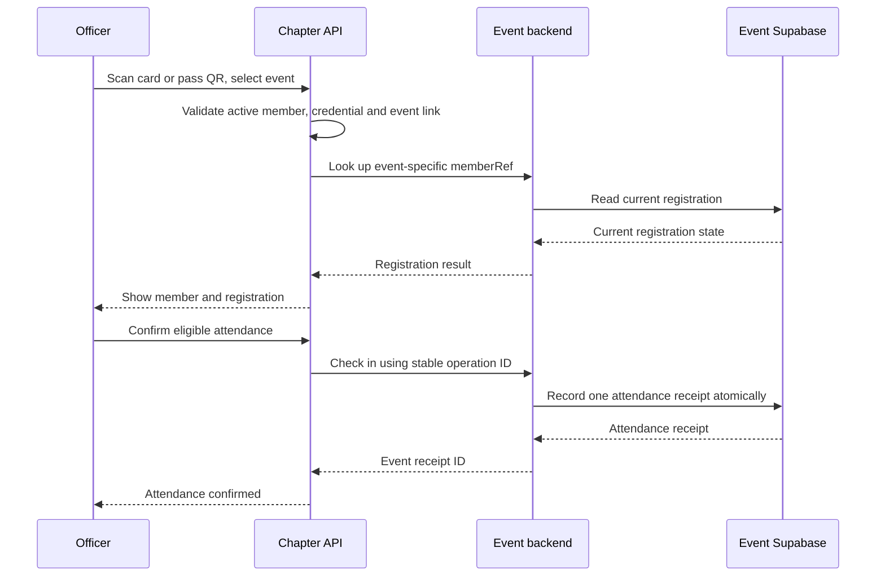

# Event websites, community membership and NFC check-in

This is the implementation and operating guide for connecting a separately hosted event to GDG at Georgia Tech. The event can have its own domain, application repository and Supabase project. The integration is implemented in this repository; each future event website must install and configure its event-side portion.

The chapter scanner can then check current community membership and that event's registration with the member's existing NFC card or pass QR. Members link their event account once before their first check-in for that event.

## Start here

There are two setup jobs:

- **Chapter Super Admin:** create the event connection, save the generated credential, select the check-in window, and optionally attach a chapter points activity.
- **Event developer:** install the event schema and adapter, connect the real registration workflow, expose the two API routes, and add the account-linking field to the event website.

Creating a connection in the chapter workspace does not install files, create an event site, provision a Supabase project or add a linking screen to another application. Those are explicit setup steps below. A future event's developer can be the same person maintaining this website.

## Data ownership and identifiers

| Data | Owner |
| --- | --- |
| Community directory and active membership | Chapter Supabase project |
| NFC/Wallet credentials and revocation | Chapter Supabase project |
| Points ledger, leaderboard and chapter perks | Chapter Supabase project |
| Event login accounts and registration details | Event Supabase project |
| Event registration acceptance, waitlist and cancellation | Event backend |
| Event attendance receipt | Event Supabase project |
| Minimal event-account link and check-in reconciliation record | Chapter Supabase project |

The event does not receive the chapter database service key, the member's card secret, their global chapter member ID or directory email through this API. It receives an event-specific `memberRef`. Different events receive different references for the same person.

The physical card and a Wallet pass may have separate revocable credentials. Both resolve to the same community member. Repeated scans, including scanning both credentials, resolve to one attendance record per member/event.

## Check-in sequence



The once-per-event account link must already exist before this sequence. Chapter points require their own subsequent Super Admin action.

## Files to use

The reusable event-side files are in [`integrations/event-membership`](../../integrations/event-membership):

| File | Purpose |
| --- | --- |
| [`schema.sql`](../../integrations/event-membership/schema.sql) | Private event registration and attendance tables; binding and attendance functions |
| [`server.mjs`](../../integrations/event-membership/server.mjs) | Framework-neutral Web Request/Response handlers and chapter API client |
| [`supabase.mjs`](../../integrations/event-membership/supabase.mjs) | Supabase server client and authenticated event-account lookup |
| [`test.sql`](../../integrations/event-membership/test.sql) | Fictional, transaction-rolled-back database regression cases |
| [`README.md`](../../integrations/event-membership/README.md) | Portable installation reference |

The chapter's schema is already installed through canonical migrations 142 and 143. Do not run the event's `schema.sql` in the chapter project or replay an already-applied chapter migration.

## 1. Prepare the event website

The event needs an HTTPS public origin and a backend capable of running Node.js server code. The example below uses a Next.js App Router website. The same two Web Request/Response handlers can be mounted by another compatible framework; a Vite-only static page needs server endpoints as well.

Use the event project's own Supabase Auth accounts and existing sign-in provider. Event accounts must have a corresponding `auth.users.id`. This integration does not add another sign-in provider.

Keep the callback at the event website's public origin. For example:

```text
Event website: https://devfest.example.org/
Callback:      https://devfest.example.org/api/gdg-membership/v1
Link endpoint: https://devfest.example.org/api/gdg-membership/link
```

These are illustrative domains. Create and configure the real event domain separately. Both endpoints must route to the event backend at that origin.

## 2. Create the chapter connection

Sign in to the chapter workspace as a Super Admin and open **Points & cards → Event connections**.

1. Enter the event's name.
2. Enter its exact HTTPS website origin with a trailing `/` and no path or custom port.
3. Set check-in opening and closing times. The allowed window is at most 31 days. The browser inputs use the officer's local timezone and submit UTC instants.
4. Optionally select a chapter points activity. Attendance will still require a separate explicit points award.
5. Leave the connection disabled until the event backend is deployed.
6. Create the connection and save the displayed event ID and server credential in private server configuration.

Copy the **entire credential**, including its event-ID prefix:

```text
<event UUID>.<secret>
```

The UI displays it after creation or key rotation. It is not listed later as plaintext. If it is lost, rotate it and update the event backend before using the connection again.

## 3. Install the event database schema

Open the **event project's** Supabase SQL editor, or add the file to that event repository's migration workflow. Apply `integrations/event-membership/schema.sql` once to a new event integration schema.

It creates:

- `gdg_event_registrations`: event Auth account ID, optional linked member reference, current status and update time.
- `gdg_event_checkins`: one attendance receipt per account, with a unique chapter operation ID.
- `gdg_event_bind`: binds the authenticated event account to its event-specific chapter reference.
- `gdg_event_attendance`: reads current registration and atomically records eligible attendance.

RLS is enabled and direct browser table/function access is revoked. The event backend uses its own service-role key. The schema includes explicit grants rather than depending on automatic Supabase API grants.

Do not run the installation repeatedly against tables that already exist. Subsequent changes belong in forward migrations. One installation represents one event per event Supabase project.

## 4. Connect the real registration workflow

The adapter must read the same current registration state that the event actually uses to admit people. Merely installing the schema leaves the registration table empty.

When the event backend accepts, waitlists or cancels a registration, write the corresponding state in the same event database transaction. The account ID must come from verified event authentication, and the status must come from the event's actual registration/capacity/payment rules.

Use this statement **inside the event's existing registration transaction/RPC**, replacing the two local variable names with that implementation's verified values:

```sql
insert into public.gdg_event_registrations
  (account_id, status, updated_at)
values
  (v_verified_account_id, v_registration_status, now())
on conflict (account_id) do update
set status = excluded.status,
    updated_at = excluded.updated_at;
```

Allowed statuses are `registered`, `waitlisted` and `cancelled`. Preserve an existing `member_ref` when the registration status changes. Extra form answers, ticket types, payment records and event-specific profile fields remain in the event's own tables.

For an already-built event, an alternative is to adapt its event-side `gdg_event_attendance` function to read the existing authoritative registration tables directly, while preserving the response contract, account binding, transaction locking and duplicate protection. Avoid an asynchronously refreshed copy that can lag behind cancellations or waitlist changes.

The current adapter expects logged-in event accounts. Guest-only registrations identified solely by a typed email need an authenticated account-claim/link workflow before they can use this member-card integration.

## 5. Configure private server variables

In the event's hosting project, configure:

| Variable | Value |
| --- | --- |
| `GDG_EVENT_ID` | Event UUID shown in chapter admin |
| `GDG_EVENT_KEY` | Entire generated `<event UUID>.<secret>` credential |
| `EVENT_ORIGIN` | Exact event origin **without** its trailing slash |
| `SUPABASE_URL` | Event project's Supabase URL |
| `SUPABASE_SERVICE_ROLE_KEY` | Event project's service-role key |

The chapter admin field uses `https://devfest.example.org/`; `EVENT_ORIGIN` uses `https://devfest.example.org`. The distinction is intentional in the existing validators.

Keep the event key and service-role key server-only. Do not prefix them with `NEXT_PUBLIC_` or `VITE_`, return them to a frontend, put them in links, or include them in logs. Each event uses its own hosting environment and Supabase credentials.

## 6. Install the backend handlers

Copy `server.mjs` and `supabase.mjs` into the event repository:

```text
lib/
  event-membership/
    server.mjs
    supabase.mjs
  gdg-event.js
app/api/gdg-membership/
  v1/route.js
  link/route.js
```

The event project needs `@supabase/supabase-js` as a dependency. In `lib/gdg-event.js`:

```js
import { createSupabaseEventIntegration } from './event-membership/supabase.mjs';

export const gdgEvent = createSupabaseEventIntegration({
  eventId: process.env.GDG_EVENT_ID,
  eventKey: process.env.GDG_EVENT_KEY,
  eventOrigin: process.env.EVENT_ORIGIN,
  supabaseUrl: process.env.SUPABASE_URL,
  supabaseServiceRoleKey: process.env.SUPABASE_SERVICE_ROLE_KEY,
});
```

In `app/api/gdg-membership/v1/route.js`:

```js
import { gdgEvent } from '../../../../lib/gdg-event';
export const runtime = 'nodejs';
export const POST = gdgEvent.verifyRequest;
```

In `app/api/gdg-membership/link/route.js`:

```js
import { gdgEvent } from '../../../../lib/gdg-event';
export const runtime = 'nodejs';
export const POST = gdgEvent.linkRequest;
```

Do not import `lib/gdg-event.js` into a client component. The machine callback must be reachable without a browser login, deployment-protection page, redirect or interactive Cloudflare challenge. Its own bearer-key check remains required. The linking endpoint separately requires the signed-in event user's token and same-origin browser request.

## 7. Add the member account-linking field

The backend endpoint is included. The future event website must also add its own field/button to call it; installing the adapter does not automatically create that screen.

A suitable location is the signed-in registration confirmation/account page. Explain that the member should open `https://leaderboards.gdggt.dev/member`, sign in with Georgia Tech, choose the event and select **Get link code**. They paste that private code into the event page once.

Example client component for the event website, using that site's existing browser Supabase client:

```jsx
'use client';
import { useState } from 'react';

export function ConnectMembership({ eventSupabase }) {
  const [code, setCode] = useState('');
  const [message, setMessage] = useState('');
  const [busy, setBusy] = useState(false);

  async function submit(event) {
    event.preventDefault();
    setBusy(true);
    setMessage('');
    try {
      const { data: { session }, error } =
        await eventSupabase.auth.getSession();
      if (error || !session) throw new Error('Sign in to this event first.');
      const response = await fetch('/api/gdg-membership/link', {
        method: 'POST',
        headers: {
          'content-type': 'application/json',
          authorization: `Bearer ${session.access_token}`,
        },
        body: JSON.stringify({ code: code.trim() }),
      });
      const result = await response.json();
      if (!response.ok) throw new Error(result.error || 'Please retry.');
      setCode('');
      setMessage('Your GDG membership is connected.');
    } catch (error) {
      setMessage(error instanceof Error ? error.message : 'Please retry.');
    } finally {
      setBusy(false);
    }
  }

  return (
    <form onSubmit={submit}>
      <label htmlFor="gdg-link-code">GDG membership link code</label>
      <input id="gdg-link-code" value={code} required
        autoComplete="off" spellCheck={false}
        onChange={event => setCode(event.target.value)} />
      <button disabled={busy || !code.trim()}>
        {busy ? 'Connecting…' : 'Connect membership'}
      </button>
      <p role="status">{message}</p>
    </form>
  );
}
```

Style this component with the event website's design system. This example is the integration logic, not a new shared visual design.

The browser uses `getSession()` only to obtain its access token. The backend verifies that token using `auth.getUser(token)` before deciding whose account to link. It never accepts an account ID from the form body. The event registration must already exist.

Codes last 10 minutes and are single-use. If the response is lost, retry with the same code and same event account while it remains valid. The chapter returns the same event reference, allowing the event binding to recover. A different event/account cannot reuse it. Do not send codes to analytics, screenshots or logs.

Chapter GT member SSO must be configured before real members can obtain these codes. The chapter-side flow is implemented behind its provider configuration flag; the request/approval and real provider validation are external setup. See [member rewards operations](MEMBER_REWARDS_OPERATIONS.md).

## 8. Enable and test the connection

Deploy the event's schema and backend, then enable the chapter connection and click **Test [event name]**. The health request checks protocol, event ID and the shared server credential. It does not prove that registration synchronization, member login or physical scanning works.

Before an actual event, test in staging with an owned fictional member/account:

1. Active community member plus accepted registration: link, scan, confirm attendance.
2. Same person scanned using their card and pass QR: one attendance record.
3. Unlinked event account: explicit linking-required result.
4. Missing, waitlisted and cancelled registration: no eligible admission.
5. Inactive community member, revoked card or disconnected event link: no admission.
6. Lost callback response: retry uses one stable attendance operation and one receipt.
7. Lost link response: retry binds the same account/reference.
8. Event outage or timeout: no unconfirmed success state.
9. Key rotation/revocation: old key stops working; update and redeploy the event key.
10. Attendance confirmation: chapter points remain unchanged until a Super Admin explicitly awards them.

Verify actual hardware separately. A software camera/NFC mock does not establish compatibility with a physical card, external writer, iPhone Safari/PWA storage or Wallet NFC reader.

## 9. Event-day check-in

In chapter admin, open **Points & cards → Event connections**, choose the enabled event, and scan the member's NFC credential or QR. On iPhone, a physical NDEF URL card opens the chapter `/tap` page through the OS notification; the signed-in Super Admin selects **External event** there. Android Web NFC and QR/manual payload entry are also supported by the existing scanner.

The chapter checks the active directory member, credential and event link. It asks the event backend for its current registration state. The officer reviews the member and confirms eligible attendance. The event database records attendance atomically; the chapter stores its reconciliation receipt. The same person gets one attendance record for that event.

Apple Wallet passes have a QR fallback. Contactless Wallet NFC additionally needs the Apple issuer certificate/entitlement, configured VAS keys and a compatible verified reader. An iPhone PWA does not provide raw NFC reading or phone-to-phone Wallet acceptance. See [NFC research](../planning/NFC_POINTS_RESEARCH.md) and the rewards operating guide for the actual supported device paths.

## API reference

### Chapter server API

Base: `https://gdggt.dev/api/v1/integrations/membership`

| Request | Body | Successful response |
| --- | --- | --- |
| `POST /redeem` | `{ "code": "…", "accountId": "event Auth user ID" }` | `{ "data": { "memberRef": "event-scoped UUID", "active": true } }` |
| `POST /verify` | `{ "memberRef": "event-scoped UUID" }` | `{ "data": { "memberRef": "…", "active": true } }` |

Both use `Authorization: Bearer <entire event credential>` and JSON. They are server-to-server calls: browser Origin/Sec-Fetch headers and cookies are rejected. `verifyMembership(memberRef)` is also exported by the event server helper for use in that event's own backend. It confirms current chapter eligibility; the event still owns its registration decision.

Missing keys return 401, forbidden/revoked credentials return 403, unknown event-scoped records return 404, invalid/expired/conflicting operations can return 409, and quota exhaustion returns 429. Treat errors as a failed verification and offer a controlled retry. Do not infer membership from a typed campus email.

### Event callback

`POST https://<event-origin>/api/gdg-membership/v1`, authenticated with the same complete event credential:

```json
{ "eventId": "…", "action": "health" }
```

Health response:

```json
{ "eventId": "…", "protocol": "gdg-membership-v1" }
```

Registration lookup:

```json
{ "eventId": "…", "action": "lookup", "memberRef": "…" }
```

Attendance confirmation:

```json
{ "eventId": "…", "action": "checkin", "memberRef": "…", "checkinId": "stable chapter operation UUID" }
```

Lookup/check-in response:

```json
{ "status": "registered", "checkedIn": true, "checkinId": "event receipt ID" }
```

Other statuses are `waitlisted`, `cancelled` and `not_registered`; these have `checkedIn: false`. A lookup does not create attendance. The chapter's operation UUID and the event's receipt ID are different identifiers.

## Retry, access and lifecycle rules

| Situation | Behavior / operator action |
| --- | --- |
| Callback interrupted after remote attendance | Retry the same chapter request; its durable operation ID is reused |
| Review expired or check-in window closed | Pending recovery can read/reconcile existing remote attendance, not initiate a fresh remote write |
| Expired review without pending attendance | Scan again during the open window |
| Connection edited or key rotated | Configuration revision changes; a fresh card review may be required |
| Missing remote receipt during recovery | No completion is claimed; scan again during check-in hours |
| Already confirmed attendance | Return the existing receipt |
| Lost card | Revoke that credential and issue a replacement; membership/history stay attached to the member |
| Directory inactivity, email change or merge | Event links and pending codes are revoked, alongside existing card/session invalidation |
| Member disconnects an event | Further chapter verification/check-in through that link is blocked |
| Member wants another event account | Officer reconciliation is required; the integration does not silently move a binding |
| Delete event Auth user | Event integration registration and attendance rows cascade-delete in that event project |
| Award chapter points | Explicit Super Admin action against the optional linked chapter activity; existing unique activity/ledger rules apply |

Event keys can be rotated or revoked from the chapter workspace. Rotation stops the previous key immediately; replace the key in the event environment and redeploy before checks can succeed again. Central API credential use expires seven days after event close. Revoking a connection disables it and replaces its key.

Event registration deletion and chapter reconciliation history are separate lifecycles. Apply the event's retention/privacy workflow to its own project. This integration does not claim an automatic cross-project erasure service or automatic history merge.

## Network and current limits

- Callback destinations must use normal public HTTPS origins with public IPv4 DNS results, no IP-literal URL/custom port and no redirects. The server checks and pins the resolved address.
- Callback DNS resolution is bounded to 3 seconds; the subsequent request is bounded to 5 seconds. Responses are limited to 8 KiB. The event handler limits incoming JSON to 2 KiB.
- Member codes expire after 10 minutes; chapter attendance reviews expire after 5 minutes. Up to 10 currently unexpired codes are allowed per member.
- An event's check-in window is at most 31 days. The current connection inventory is bounded to 200; admin shows the latest 100 attendance records.
- The chapter integration route group currently applies a 120 requests/minute rate limit per risk/IP bucket. Event backends must handle 429; do not promise unlimited burst throughput.
- The supplied schema represents one event per event project. Multiple simultaneous events in one project require an explicit schema/adapter extension.
- Event accounts and the one-time membership link are required. This implementation does not automatically match independent accounts using their email or treat a raw card as proof that its holder owns an unrelated event account.
- Scanning is online. Static card/QR credentials can be copied; officers still confirm the person being admitted. Neither an offline success cache nor a contactless anti-cloning scheme is provided.

## Troubleshooting

| Symptom | Check |
| --- | --- |
| Test event fails | Deployed origin, exact event ID/full key, correct Node route, HTTPS/certificate, firewall and redirect behavior |
| 401 from callback | Complete `<event UUID>.<secret>` credential and correct event ID |
| 403 from central integration | Disabled/revoked connection, rotated key, credential expiry, or accidental browser headers/cookies |
| Sign in to this event first | Valid event Supabase access token; event backend must call the event project's `auth.getUser` |
| Register for this event first | Event registration row exists for that authenticated account ID |
| Not registered despite a ticket | Registration transaction is writing the adapter's actual authoritative table and account mapping |
| Event account not linked | Member completes the once-per-event code flow using the intended signed-in event account |
| Code no longer works | Correct event/account, 10-minute expiry, current chapter session and unchanged directory eligibility |
| SQL permission denied | Schema installed in the event project; explicit service-role table/function grants applied; server-only service key configured |
| Awaiting confirmation | Retry the same request; inspect the event receipt before assuming attendance failed |
| Card opens a signed-out page on iPhone | Open the handoff in the officer's authenticated browser; Safari and an installed PWA may hold different sessions |
| Points did not change | Attendance and chapter points are separate; check the optional activity and explicit Super Admin award |

## Verification and maintenance

Run these from this chapter repository for the reusable implementation:

```sh
npm run test:event-membership
npm run test:db
npm run test:db:legacy-grants
npx vitest run tests/server/reward-events.test.mjs tests/server/event-membership-adapter.test.mjs tests/client/reward-events-ui.test.tsx
npx playwright test tests/browser/reward-events.spec.ts tests/browser/rewards.spec.ts
```

The standalone database test uses a disposable PostgreSQL instance, including registration states, account binding, explicit grants, event-user deletion and 50 concurrent duplicate taps. These commands use fictional data, not actual event admissions or chapter points.

Published implementation: commit `933a70f`, chapter migrations 142/143. Its release passed all seven CI jobs, 2,929 source tests and 2,012 browser cases, with 10 existing viewport/WebGL capability skips. Actual anonymous desktop/mobile routes and the existing Super Admin connection screen were checked live. This establishes the shared integration's release state, not acceptance of an event website that has not yet been created or configured.

Official implementation references: [Supabase server user verification](https://supabase.com/docs/reference/javascript/auth-getuser), [server-side authentication](https://supabase.com/docs/guides/auth/server-side/creating-a-client), [explicit Data API grants](https://supabase.com/docs/guides/api/securing-your-api), [server-only keys and RLS](https://supabase.com/docs/guides/database/secure-data).
